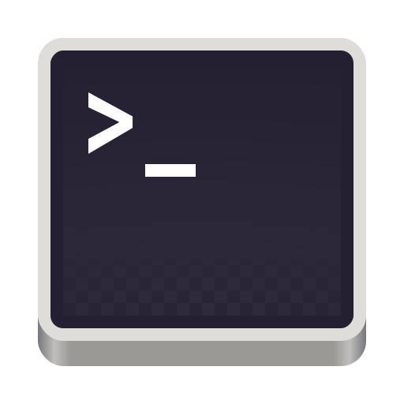

```
 ███╗   ███╗██╗   ██╗     ███████╗██╗  ██╗███████╗██╗     ██╗     
 ████╗ ████║╚██╗ ██╔╝     ██╔════╝██║  ██║██╔════╝██║     ██║     
 ██╔████╔██║ ╚████╔╝█████╗███████╗███████║█████╗  ██║     ██║     
 ██║╚██╔╝██║  ╚██╔╝ ╚════╝╚════██║██╔══██║██╔══╝  ██║     ██║     
 ██║ ╚═╝ ██║   ██║        ███████║██║  ██║███████╗███████╗███████╗
 ╚═╝     ╚═╝   ╚═╝        ╚══════╝╚═╝  ╚═╝╚══════╝╚══════╝╚══════╝
```

<div align="center">
  
  
 </div>

Personal dotfiles for Bash, Zsh, tmux, and Ghostty — designed to work across macOS, Arch Linux, Ubuntu, Fedora, and NixOS. Uses [GNU Stow](https://www.gnu.org/software/stow/) to symlink files into `$HOME` and a modular installer that can set up or revert everything in one command.

## Quick Start

```bash
git clone <repo-url> ~/Projects/my-shell
cd ~/Projects/my-shell
./install          # install everything
./install -r       # uninstall and revert to backups
./install -s       # choose which modules to run
```

`./install` detects your OS and runs the matching installer in `install.d/<os>/` (currently `macos` and `arch`, which also covers CachyOS, EndeavourOS and Manjaro). That installer runs each of its modules: packages, directories, Git, Bash, Zsh, and stowing the dotfiles. With `-r`, modules are undone in reverse order.

## Binaries

- fzf
- stow
- neovim
- vim
- zoxide
- starship
- git
- lsd
- ripgrep
- tree
- zsh

### Arch/CachyOS

- yay
